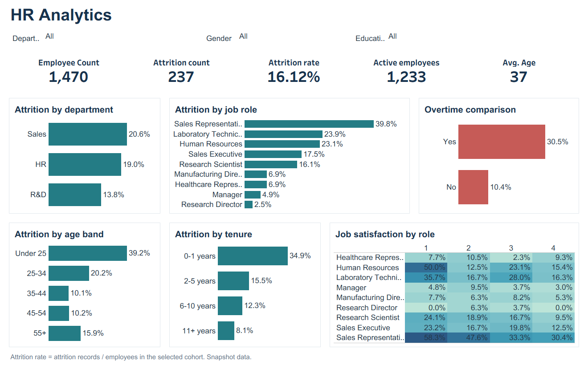

# HR Analytics

Analysis of 1,470 employee records using Tableau, Python and SQL. The project compares attrition rates across departments, job roles, overtime status, age, tenure and job satisfaction.

The image is exported from the verified Tableau dashboard. [Open the interactive preview](HR_Analytics_Preview.html) locally for department, gender and education filters, cohort counts on hover, and department selection.

[Download the Tableau workbook](hr%20analytics%20dashboard.twbx)

## Findings

| Comparison | Attrition records / employees | Attrition rate |
|---|---:|---:|
| Overall | 237 / 1,470 | 16.12% |
| Sales | 92 / 446 | 20.63% |
| R&D | 133 / 961 | 13.84% |
| Overtime: Yes | 127 / 416 | 30.53% |
| Overtime: No | 110 / 1,054 | 10.44% |
| Tenure: 0–1 years | 75 / 215 | 34.88% |
| Sales Representative | 33 / 83 | 39.76% |

R&D has the largest number of attrition records, while Sales has the higher department rate. Overtime groups differ by 20.09 percentage points. Early-tenure and Sales Representative cohorts are useful starting points for reviewing onboarding, workloads and exit feedback. These are associations within the supplied snapshot; the analysis does not establish causes.

## Dashboard

The redesigned native workbook contains seven worksheets: workforce KPIs, department rates, ranked job-role rates, overtime comparisons, age bands, tenure bands and a job-role/satisfaction heatmap.

Department, gender and education dropdowns share one source. Selecting a department filters the other views. Tooltips include employee counts and attrition records alongside the rate. Calculated fields use conditional expressions and aggregate ratios. The packaged workbook retains the original extract and includes its Excel refresh source.

[Calculated fields](tableau/calculated_fields.md)

## Data and definitions

The input is **HR Data.xlsx** from this repository, matching the fields and headline totals in the supplied Tableau package. Each row represents one employee. Employee Number is unique, Employee Count equals one, and the source contains no missing required fields or duplicate employee IDs.

Attrition rate is the number of records with Attrition = Yes divided by all employee records in the selected cohort. Active employees means Attrition = No. This is an undated snapshot, so the result is not an annual turnover rate. Monthly income has no documented currency and is not used for a currency comparison.

Age bands are derived directly from Age. Tenure bands are derived from Years At Company. Originals are retained without dropping records. The preparation script trims text, normalizes Yes/No values, checks types and categories, and rejects unexpected duplicate IDs or missing required values.

## Reproduce the analysis

~~~bash
python -m pip install -r requirements.txt
python src/prepare_hr.py
~~~

The script prepares `data/hr_analytics.csv`, loads a local SQLite database and executes the ten analysis queries in `sql/hr_analysis.sql`. SQL uses CASE, aggregation, CTEs, NULLIF and DENSE_RANK. It is executed with SQLite 3; this project does not claim a live MySQL connection.

The results folder contains cohort summaries, metrics and validation checks. The database is generated locally and excluded from version control.

## Verification

- 62 data and SQL reconciliation checks passed.
- Cohort populations and attrition counts reconcile to the overall totals.
- The interactive preview is checked against SQL for individual, combined and empty filter selections.
- Native package structure, worksheet references and retained extract bytes are checked.
- Opened and saved in Tableau Desktop 2026.2 without load errors or field-removal warnings.
- Verified the gender filter, department selection, clearing a selection, and department tooltips against the SQL totals.

The source extract and the raw Excel file remain unchanged.
